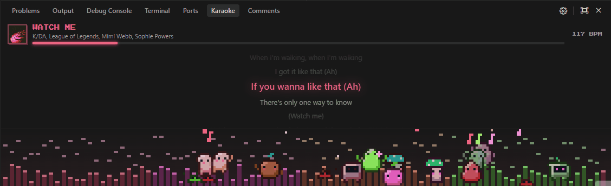

# VSCaraoke 🎤

Your code editor, but it sings.

VSCaraoke adds a little panel to VS Code that shows synced lyrics for whatever you're playing on Spotify. Below the lyrics, your pixelated fans dance along to the beat. They have no training but it's enough to look cute.

## Meet the crew

| | |
|---|---|
| **Sproutling** | Round, pink-ish, has a leaf. The original. |
| **Capling** | A mushroom with moves. |
| **Wisp** | A tiny ghost. Doesn't hop, does loops instead. |
| **Beepbox** | A robot with a screen for a face. Blinks its antenna on the beat. |
| **Dribble** | A slime drop. Very bouncy. |
| **Skitter** | Bugs. The dance floor is outside. Noone wants them there. |

Every bar they pick a new move: bob, hop, sway, wave, spin, stomp, headbang. Sometimes one leaps across the stage. Sometimes one trips and lies there for a few beats. It happens. There's confetti every 8 bars, music notes and hearts float up, and their colors come from the album cover.

**Click the dance floor** to give everyone a fresh paint job.

## Setup (about 3 minutes)

Spotify wants every app to have its own key, so you'll need to make one. Spotify Premium is unfortunately required for this to work. If you have it, it is free:

1. Go to the [Spotify Developer Dashboard](https://developer.spotify.com/dashboard) and create an app.
   - **Redirect URI:** `http://127.0.0.1:43821/callback`
   - **API:** Web API
2. Copy the app's **Client ID** into the `vscaraoke.spotifyClientId` setting.
3. Open the **VSCaraoke** tab in the bottom panel (next to Terminal) and hit **Sign in to Spotify**.
4. Play something and sing along (required)

Port 43821 already taken for whatever reason? Set `vscaraoke.redirectUri` to another one, like `http://127.0.0.1:8888/callback`, and add that exact URL to your Spotify app instead.

## Make it yours

Click the ⚙ in the panel's title bar to open all settings.

| Setting | Default | |
|---|---|---|
| `vscaraoke.chaos` | `lively` | `calm`, `lively` or `chaos`. `chaos` comes with screen shake. You've been warned. |
| `vscaraoke.creatureCount` | `6` | Up to 12 dancers. |
| `vscaraoke.species` | all | Pick your favorites, e.g. `["wisp", "beepbox"]`. |
| `vscaraoke.lineFill` | `instant` | `instant` lights up the whole line. `sweep` fills it as it's sung. |
| `vscaraoke.showVisualizer` | on | The bars behind the crowd. |
| `vscaraoke.stageHeight` | `112` | More room for the dance floor. |
| `vscaraoke.lyricsOffsetMs` | `0` | Lyrics consistently early or late? Nudge them here. |
| `vscaraoke.redirectUri` | `http://127.0.0.1:43821/callback` | Only if you need a different sign-in port. |

## When things are a little off

- **Wrong lyrics?** Run **VSCaraoke: Search Lyrics Manually** and pick the right ones. VSCaraoke remembers your pick for that song.
- **Lyrics a bit early or late?** **VSCaraoke: Show Lyrics Earlier / Later** shifts them in 250 ms steps.
- **Creatures dancing off-beat?** Some songs have no tempo info. Click the BPM label in the top right 3–4 times along with the beat to set it.

## How it works

- **Lyrics** come from [LRCLIB](https://lrclib.net), a free community lyrics database. If the exact title doesn't match, VSCaraoke cleans it up (drops "Remastered", "feat." and similar) and tries again.
- **Tempo** comes from [ReccoBeats](https://reccobeats.com) when they know the song.
- **The visualizer is fake.** VS Code can't hear your music, so the bars and dancers follow the song's tempo instead of the actual sound. Don't tell them, they are still having fun.

## Invite your friends to your own place

The creatures are text grids in [src/webview/sprites.ts](src/webview/sprites.ts), one digit per color. Copy one, redraw it, and you have a new species.

To work on the stage without Spotify, run `npm run compile` and open [dev/preview.html](dev/preview.html) in a browser. It plays a fake song with controls for tempo, chaos and colors. Try `preview.html?chaos=chaos&count=12`.

## Credits

Pixel font: Press Start 2P by CodeMan38 (SIL Open Font License, see `media/fonts/OFL.txt`).

## License

MIT, see [LICENSE](LICENSE).
